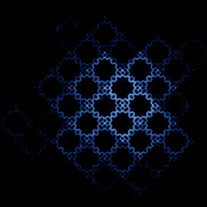

# Popcorn

`popcorn` · map · 2-D · family: Maps



Pickover's popcorn — not an attractor but a chaotic scattering of many starting points into kernels of "popcorn".

## Equations

```text
x′ = x − h · sin(y + tan(k · y))
y′ = y − h · sin(x + tan(k · x))
```

## Parameters

| Name | Default | Range | Meaning |
|---|---|---|---|
| h | 0.05 | [0.01, 0.2] |  |
| k | 3 | [1, 6] |  |

## References

- C. A. Pickover, "Computers, Pattern, Chaos and Beauty"

## Source (`.atr`)

```text
name: Popcorn
family: Maps
desc: Pickover's popcorn — not an attractor but a chaotic scattering of many starting points into kernels of "popcorn".
ref: C. A. Pickover, "Computers, Pattern, Chaos and Beauty"
tags: map, 2d
dims: 2
ic: 0 0 0
jitter: 6.0
warmup: 0

param h = 0.05 [0.01, 0.2]
param k = 3.0 [1, 6]

x' = x - h*sin(y + tan(k*y))
y' = y - h*sin(x + tan(k*x))
```

Render it: `attractr render popcorn --size 2048x2048 --report md`
