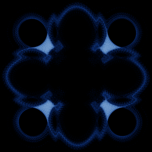

# Quadrup-Two

`quadrup_two` · map · 2-D · family: Maps



Barry Martin's "Quadrup-Two" — Hopalong's wilder sibling. Nested logs and an arctangent replace the square root and the orbit bursts into lace-like sprays.

## Equations

```text
x′ = y − sign(x) · sin(log(abs(b · x − c))) · atan(log(abs(c · x − b))²)
y′ = a − x
```

## Parameters

| Name | Default | Range | Meaning |
|---|---|---|---|
| a | 34 | [-50, 50] |  |
| b | 1 | [-5, 5] |  |
| c | 5 | [-10, 10] |  |

## References

- B. Martin, in A. K. Dewdney, Scientific American (1986); P. Bourke, "Quadrup Two"

## Source (`.atr`)

```text
name: Quadrup-Two
family: Maps
desc: Barry Martin's "Quadrup-Two" — Hopalong's wilder sibling. Nested logs and an arctangent replace the square root and the orbit bursts into lace-like sprays.
ref: B. Martin, in A. K. Dewdney, Scientific American (1986); P. Bourke, "Quadrup Two"
tags: map, 2d, classic
dims: 2
ic: 0 0 0
jitter: 0.5
warmup: 100

param a = 34 [-50, 50]
param b = 1 [-5, 5]
param c = 5 [-10, 10]

x' = y - sign(x)*sin(log(abs(b*x - c)))*atan(log(abs(c*x - b))^2)
y' = a - x
```

Render it: `attractr render quadrup_two --size 2048x2048 --report md`
