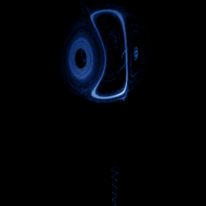

# Rabinovich-Fabrikant

`rabinovich_fabrikant` · flow · 3-D · family: Flows



Plasma-physics waves — a delicate, layered attractor that is sensitive to the integration step.

## Equations

```text
dx/dt = y · (z − 1 + x²) + γ · x
dy/dt = x · (3 · z + 1 − x²) + γ · y
dz/dt = −2 · z · (α + x · y)
```

## Parameters

| Name | Default | Range | Meaning |
|---|---|---|---|
| alpha | 0.14 | [0.05, 0.3] | α |
| gamma | 0.1 | [0.05, 0.3] | γ |

Integration: RK4, default dt = 0.01, initial condition (-1.0, 0.0, 0.5).

## References

- M. I. Rabinovich & A. L. Fabrikant, Sov. Phys. JETP 50 (1979)

## Source (`.atr`)

```text
name: Rabinovich-Fabrikant
family: Flows
desc: Plasma-physics waves — a delicate, layered attractor that is sensitive to the integration step.
ref: M. I. Rabinovich & A. L. Fabrikant, Sov. Phys. JETP 50 (1979)
tags: flow, 3d
dt: 0.01
ic: -1 0 0.5
camera: 25 20 0 1

param alpha = 0.14 [0.05, 0.3] "α"
param gamma = 0.10 [0.05, 0.3] "γ"

dx = y*(z - 1 + x^2) + gamma*x
dy = x*(3*z + 1 - x^2) + gamma*y
dz = -2*z*(alpha + x*y)
```

Render it: `attractr render rabinovich_fabrikant --size 2048x2048 --report md`
