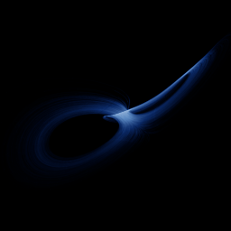

# Rikitake

`rikitake` · flow · 3-D · family: Flows



The two-disc dynamo model of geomagnetic reversals.

## Equations

```text
dx/dt = −μ · x + y · z
dy/dt = −μ · y + (z − a) · x
dz/dt = 1 − x · y
```

## Parameters

| Name | Default | Range | Meaning |
|---|---|---|---|
| mu | 2 | [1, 3] | μ — dissipation. |
| a | 5 | [3, 7] | Difference of the angular velocities. |

Integration: RK4, default dt = 0.02, initial condition (0.1, 0.1, 0.1, 0.0).

## References

- T. Rikitake, Proc. Cambridge Phil. Soc. 54 (1958)

## Source (`.atr`)

```text
name: Rikitake
family: Flows
desc: The two-disc dynamo model of geomagnetic reversals.
ref: T. Rikitake, Proc. Cambridge Phil. Soc. 54 (1958)
tags: flow, 3d
dt: 0.02
ic: 0.1 0.1 0.1
camera: 25 20 0 1

param mu = 2.0 [1, 3] "μ — dissipation."
param a = 5.0 [3, 7] "Difference of the angular velocities."

dx = -mu*x + y*z
dy = -mu*y + (z - a)*x
dz = 1 - x*y
```

Render it: `attractr render rikitake --size 2048x2048 --report md`
