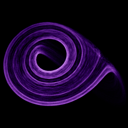

# Rössler

`rossler` · flow · 3-D · family: Flows



A simpler cousin of Lorenz. Spirals slowly outward on a flat band then snaps up and back — like a cosmic pinball.

## Equations

```text
dx/dt = −(y + z)
dy/dt = x + a · y
dz/dt = b + z · (x − c)
```

## Parameters

| Name | Default | Range | Meaning |
|---|---|---|---|
| a | 0.2 | [0, 1] | Inner spiral rate — how fast orbits expand on the flat plane. |
| b | 0.2 | [0, 1] | Lift — base rate at which z grows. |
| c | 5.7 | [0, 10] | Fold threshold — where the band snaps up. Larger c = wilder fold. |

Integration: RK4, default dt = 0.02, initial condition (0.1, 0.0, 0.0).

## References

- O. E. Rössler, "An equation for continuous chaos", Phys. Lett. A 57 (1976)

## Source (`.atr`)

```text
name: Rössler
family: Flows
desc: A simpler cousin of Lorenz. Spirals slowly outward on a flat band then snaps up and back — like a cosmic pinball.
ref: O. E. Rössler, "An equation for continuous chaos", Phys. Lett. A 57 (1976)
tags: flow, 3d
dt: 0.02
ic: 0.1 0 0
camera: 20 30 0 1
palette: aurora
param a = 0.2 [0, 1] "Inner spiral rate — how fast orbits expand on the flat plane."
param b = 0.2 [0, 1] "Lift — base rate at which z grows."
param c = 5.7 [0, 10] "Fold threshold — where the band snaps up. Larger c = wilder fold."

dx = -(y + z)
dy = x + a*y
dz = b + z*(x - c)
```

Render it: `attractr render rossler --size 2048x2048 --report md`
