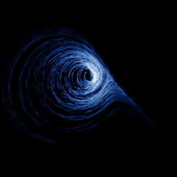

# Rössler hyperchaos

`rossler_hyperchaos` · flow · 3-D · family: Flows



The first hyperchaotic system (1979): a four-dimensional flow with *two* positive Lyapunov exponents. The 4th variable w lives in the kernel's hidden state; the picture is the (x, y, z) projection.

## Equations

```text
dx/dt = −y − z
dy/dt = x + a · y + w
dz/dt = b + x · z
dw = −c · z + d · w
```

## Parameters

| Name | Default | Range | Meaning |
|---|---|---|---|
| a | 0.25 | [0, 0.5] |  |
| b | 3 | [0, 5] |  |
| c | 0.5 | [0, 1] |  |
| d | 0.05 | [0, 0.2] |  |

Integration: RK4, default dt = 0.005, initial condition (-10.0, -6.0, 0.0, 10.0).

## References

- O. E. Rössler, "An equation for hyperchaos", Phys. Lett. A 71 (1979)

## Source (`.atr`)

```text
name: Rössler hyperchaos
family: Flows
desc: The first hyperchaotic system (1979): a four-dimensional flow with *two* positive Lyapunov exponents. The 4th variable w lives in the kernel's hidden state; the picture is the (x, y, z) projection.
ref: O. E. Rössler, "An equation for hyperchaos", Phys. Lett. A 71 (1979)
tags: flow, 4d, hyperchaos
dt: 0.005
ic: -10 -6 0 10
camera: 25 20 0 1
warmup: 3000

param a = 0.25 [0, 0.5]
param b = 3 [0, 5]
param c = 0.5 [0, 1]
param d = 0.05 [0, 0.2]

dx = -y - z
dy = x + a*y + w
dz = b + x*z
dw = -c*z + d*w
```

Render it: `attractr render rossler_hyperchaos --size 2048x2048 --report md`
