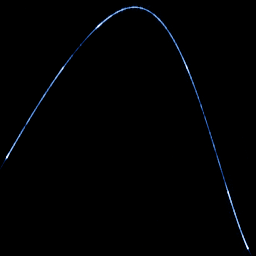

# Rössler return map

`rossler_return_map` · flow · 2-D · family: Flows



Successive maxima of x in the Rössler flow, xₙ₊₁ against xₙ — a one-humped curve that shows the band's single fold, the same way the Lorenz map shows its cusp. The previous maximum is carried in w by the on_section block.

## Equations

```text
dx/dt = −y − z
dy/dt = x + a · y
dz/dt = b + z · (x − c)
dw = 0
plot = w, x, 0
section = −y − z
at each section crossing:
    w′ = x
```

## Parameters

| Name | Default | Range | Meaning |
|---|---|---|---|
| a | 0.2 | [0, 0.5] |  |
| b | 0.2 | [0, 2] |  |
| c | 5.7 | [2, 14] |  |

Integration: RK4, default dt = 0.01, initial condition (1.0, 1.0, 0.0, 0.0).

## References

- O. E. Rössler, "An equation for continuous chaos", Phys. Lett. A 57 (1976)

## Source (`.atr`)

```text
name: Rössler return map
family: Flows
desc: Successive maxima of x in the Rössler flow, xₙ₊₁ against xₙ — a one-humped curve that shows the band's single fold, the same way the Lorenz map shows its cusp. The previous maximum is carried in w by the on_section block.
ref: O. E. Rössler, "An equation for continuous chaos", Phys. Lett. A 57 (1976)
tags: flow, section, return map, classic
dt: 0.01
ic: 1 1 0 0
camera: 0 0 0 1
warmup: 3000
boost: 100
section_dir: down

param a = 0.2 [0, 0.5]
param b = 0.2 [0, 2]
param c = 5.7 [2, 14]

dx = -y - z
dy = x + a*y
dz = b + z*(x - c)
dw = 0
plot = w, x, 0
section = -y - z
on_section { w' = x }
```

Render it: `attractr render rossler_return_map --size 2048x2048 --report md`
