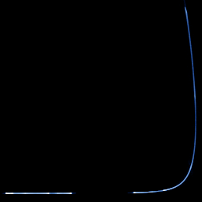

# Rössler (Poincaré section)

`rossler_section` · flow · 2-D · family: Flows



Rössler's band cut by the half-plane y = 0 — each orbit leaves one dot per turn. The dots line up on a folded curve: the one-dimensional "Rössler map" that Rössler himself used to explain the stretching and folding.

## Equations

```text
dx/dt = −y − z
dy/dt = x + a · y
dz/dt = b + z · (x − c)
plot = x, z, 0
section = y
```

## Parameters

| Name | Default | Range | Meaning |
|---|---|---|---|
| a | 0.2 | [0, 0.5] |  |
| b | 0.2 | [0, 2] |  |
| c | 5.7 | [2, 14] |  |

Integration: RK4, default dt = 0.01, initial condition (1.0, 1.0, 0.0, 0.0).

## References

- O. E. Rössler, "An equation for continuous chaos", Phys. Lett. A 57 (1976)

## Source (`.atr`)

```text
name: Rössler (Poincaré section)
family: Flows
desc: Rössler's band cut by the half-plane y = 0 — each orbit leaves one dot per turn. The dots line up on a folded curve: the one-dimensional "Rössler map" that Rössler himself used to explain the stretching and folding.
ref: O. E. Rössler, "An equation for continuous chaos", Phys. Lett. A 57 (1976)
tags: flow, section, classic
dt: 0.01
ic: 1 1 0
camera: 0 0 0 1
warmup: 3000
boost: 150

param a = 0.2 [0, 0.5]
param b = 0.2 [0, 2]
param c = 5.7 [2, 14]

dx = -y - z
dy = x + a*y
dz = b + z*(x - c)
plot = x, z, 0
section = y
```

Render it: `attractr render rossler_section --size 2048x2048 --report md`
