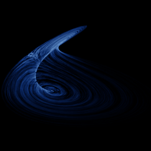

# Rucklidge

`rucklidge` · flow · 3-D · family: Flows



Double convection model — a thin, twisted double-scroll ribbon.

## Equations

```text
dx/dt = −κ · x + λ · y − y · z
dy/dt = x
dz/dt = −z + y²
```

## Parameters

| Name | Default | Range | Meaning |
|---|---|---|---|
| kappa | 2 | [0.5, 4] | κ — damping of the velocity mode. |
| lam | 6.7 | [3, 10] | λ — forcing. |

Integration: RK4, default dt = 0.01, initial condition (1.0, 0.0, 4.5, 0.0).

## References

- A. M. Rucklidge, J. Fluid Mech. 237 (1992)

## Source (`.atr`)

```text
name: Rucklidge
family: Flows
desc: Double convection model — a thin, twisted double-scroll ribbon.
ref: A. M. Rucklidge, J. Fluid Mech. 237 (1992)
tags: flow, 3d
dt: 0.01
ic: 1 0 4.5
camera: 25 20 0 1

param kappa = 2.0 [0.5, 4] "κ — damping of the velocity mode."
param lam = 6.7 [3, 10] "λ — forcing."

dx = -kappa*x + lam*y - y*z
dy = x
dz = -z + y^2
```

Render it: `attractr render rucklidge --size 2048x2048 --report md`
