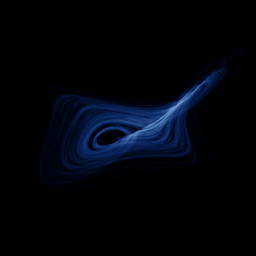

# Sakarya

`sakarya` · flow · 3-D · family: Flows



A recent chaotic system with a broad, leaf-like attractor.

## Equations

```text
dx/dt = −x + y + y · z
dy/dt = −x − y + a · x · z
dz/dt = z − b · x · y
```

## Parameters

| Name | Default | Range | Meaning |
|---|---|---|---|
| a | 0.4 | [0.2, 0.6] |  |
| b | 0.3 | [0.1, 0.5] |  |

Integration: RK4, default dt = 0.01, initial condition (1.0, -1.0, 1.0, 0.0).

## Source (`.atr`)

```text
name: Sakarya
family: Flows
desc: A recent chaotic system with a broad, leaf-like attractor.

tags: flow, 3d
dt: 0.01
ic: 1 -1 1
camera: 25 20 0 1

param a = 0.4 [0.2, 0.6]
param b = 0.3 [0.1, 0.5]

dx = -x + y + y*z
dy = -x - y + a*x*z
dz = z - b*x*y
```

Render it: `attractr render sakarya --size 2048x2048 --report md`
