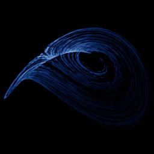

# Shimizu-Morioka

`shimizu_morioka` · flow · 3-D · family: Flows



A Lorenz-like system near the homoclinic butterfly — thin, delicate wings.

## Equations

```text
dx/dt = y
dy/dt = x − a · y − x · z
dz/dt = −b · z + x²
```

## Parameters

| Name | Default | Range | Meaning |
|---|---|---|---|
| a | 0.75 | [0.5, 1] |  |
| b | 0.45 | [0.2, 0.8] |  |

Integration: RK4, default dt = 0.01, initial condition (0.1, 0.1, 0.1, 0.0).

## References

- T. Shimizu & N. Morioka, Phys. Lett. A 76 (1980)

## Source (`.atr`)

```text
name: Shimizu-Morioka
family: Flows
desc: A Lorenz-like system near the homoclinic butterfly — thin, delicate wings.
ref: T. Shimizu & N. Morioka, Phys. Lett. A 76 (1980)
tags: flow, 3d
dt: 0.01
ic: 0.1 0.1 0.1
camera: 25 20 0 1

param a = 0.75 [0.5, 1]
param b = 0.45 [0.2, 0.8]

dx = y
dy = x - a*y - x*z
dz = -b*z + x^2
```

Render it: `attractr render shimizu_morioka --size 2048x2048 --report md`
