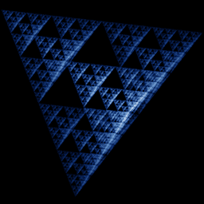

# Sierpinski Tetrahedron

`sierpinski_tetrahedron` · ifs · 3-D · family: IFS



The chaos game in 3-D: jump half-way towards one of four tetrahedron vertices. A true 3-D fractal to rotate.

## Equations

```text
with p = 1:
    x′ = x + (1 − x) · s
    y′ = y + (1 − y) · s
    z′ = z + (1 − z) · s
with p = 1:
    x′ = x + (−1 − x) · s
    y′ = y + (−1 − y) · s
    z′ = z + (1 − z) · s
with p = 1:
    x′ = x + (−1 − x) · s
    y′ = y + (1 − y) · s
    z′ = z + (−1 − z) · s
with p = 1:
    x′ = x + (1 − x) · s
    y′ = y + (−1 − y) · s
    z′ = z + (−1 − z) · s
```

## Parameters

| Name | Default | Range | Meaning |
|---|---|---|---|
| s | 0.5 | [0.3, 0.7] | Contraction towards the chosen vertex (0.5 is the classic gasket). |

## Source (`.atr`)

```text
name: Sierpinski Tetrahedron
family: IFS
desc: The chaos game in 3-D: jump half-way towards one of four tetrahedron vertices. A true 3-D fractal to rotate.
tags: ifs, 3d
warmup: 20
ic: 0 0 0
camera: 30 25 0 1

param s = 0.5 [0.3, 0.7] "Contraction towards the chosen vertex (0.5 is the classic gasket)."

choose {
  1: x' = x + (1 - x)*s;  y' = y + (1 - y)*s;  z' = z + (1 - z)*s
  1: x' = x + (-1 - x)*s; y' = y + (-1 - y)*s; z' = z + (1 - z)*s
  1: x' = x + (-1 - x)*s; y' = y + (1 - y)*s;  z' = z + (-1 - z)*s
  1: x' = x + (1 - x)*s;  y' = y + (-1 - y)*s; z' = z + (-1 - z)*s
}
```

Render it: `attractr render sierpinski_tetrahedron --size 2048x2048 --report md`
