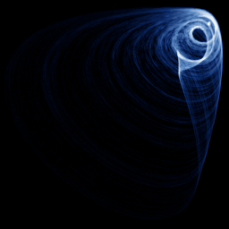

# Sprott D

`sprott_d` · flow · 3-D · family: Flows



One of J. C. Sprott's 19 simplest chaotic flows (case D) — five terms, one or two nonlinearities.

## Equations

```text
dx/dt = −y
dy/dt = x + z
dz/dt = x · z + 3 · y²
```

Integration: RK4, default dt = 0.02, initial condition (0.11, 0.08, 0.14).

## References

- J. C. Sprott, "Some simple chaotic flows", Phys. Rev. E 50 (1994)

## Source (`.atr`)

```text
name: Sprott D
family: Flows
desc: One of J. C. Sprott's 19 simplest chaotic flows (case D) — five terms, one or two nonlinearities.
ref: J. C. Sprott, "Some simple chaotic flows", Phys. Rev. E 50 (1994)
tags: flow, sprott, 3d
dt: 0.02
ic: 0.11 0.08 0.14
camera: 25 20 0 1


dx = -y
dy = x + z
dz = x*z + 3*y^2
```

Render it: `attractr render sprott_d --size 2048x2048 --report md`
