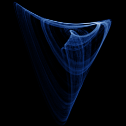

# Sprott G

`sprott_g` · flow · 3-D · family: Flows



One of J. C. Sprott's 19 simplest chaotic flows (case G) — five terms, one or two nonlinearities.

## Equations

```text
dx/dt = a · x + b · z
dy/dt = x · z − y
dz/dt = −x + y
```

## Parameters

| Name | Default | Range | Meaning |
|---|---|---|---|
| a | 0.4 | [0.1, 1] |  |
| b | 1 | [0.5, 2] |  |

Integration: RK4, default dt = 0.02, initial condition (0.1, 0.1, 0.1).

## References

- J. C. Sprott, "Some simple chaotic flows", Phys. Rev. E 50 (1994)

## Source (`.atr`)

```text
name: Sprott G
family: Flows
desc: One of J. C. Sprott's 19 simplest chaotic flows (case G) — five terms, one or two nonlinearities.
ref: J. C. Sprott, "Some simple chaotic flows", Phys. Rev. E 50 (1994)
tags: flow, sprott, 3d
dt: 0.02
ic: 0.1 0.1 0.1
camera: 25 20 0 1

param a = 0.4 [0.1, 1]
param b = 1.0 [0.5, 2]

dx = a*x + b*z
dy = x*z - y
dz = -x + y
```

Render it: `attractr render sprott_g --size 2048x2048 --report md`
