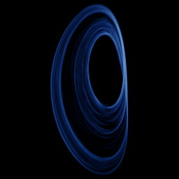

# Sprott I

`sprott_i` · flow · 3-D · family: Flows



One of J. C. Sprott's 19 simplest chaotic flows (case I) — five terms, one or two nonlinearities.

## Equations

```text
dx/dt = −a · y
dy/dt = x + z
dz/dt = x + y² − b · z
```

## Parameters

| Name | Default | Range | Meaning |
|---|---|---|---|
| a | 0.2 | [0.05, 0.5] |  |
| b | 1 | [0.5, 2] |  |

Integration: RK4, default dt = 0.02, initial condition (0.1, 0.1, 0.1, 0.0).

## References

- J. C. Sprott, "Some simple chaotic flows", Phys. Rev. E 50 (1994)

## Source (`.atr`)

```text
name: Sprott I
family: Flows
desc: One of J. C. Sprott's 19 simplest chaotic flows (case I) — five terms, one or two nonlinearities.
ref: J. C. Sprott, "Some simple chaotic flows", Phys. Rev. E 50 (1994)
tags: flow, sprott, 3d
dt: 0.02
ic: 0.1 0.1 0.1
camera: 25 20 0 1

param a = 0.2 [0.05, 0.5]
param b = 1.0 [0.5, 2]

dx = -a*y
dy = x + z
dz = x + y^2 - b*z
```

Render it: `attractr render sprott_i --size 2048x2048 --report md`
