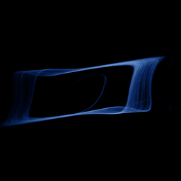

# Sprott cubic jerk

`sprott_jerk_cubic` · flow · 3-D · family: Flows



Sprott's simplest cubic chaotic jerk x''' = −a·x'' + x·x'² − x. A cousin of the quadratic case with a rounder, more symmetric scroll.

## Equations

```text
dx/dt = y
dy/dt = z
dz/dt = −a · z + x · y² − x
```

## Parameters

| Name | Default | Range | Meaning |
|---|---|---|---|
| a | 2.028 | [1.9, 2.2] | a — damping. |

Integration: RK4, default dt = 0.02, initial condition (0.5, 0.0, 0.0, 0.0).

## References

- J. C. Sprott, "Elegant Chaos" (2010)

## Source (`.atr`)

```text
name: Sprott cubic jerk
family: Flows
desc: Sprott's simplest cubic chaotic jerk x''' = −a·x'' + x·x'² − x. A cousin of the quadratic case with a rounder, more symmetric scroll.
ref: J. C. Sprott, "Elegant Chaos" (2010)
tags: flow, jerk, 3d
dt: 0.02
ic: 0.5 0 0
jitter: 0.02
camera: 25 20 0 1

param a = 2.028 [1.9, 2.2] "a — damping."

dx = y
dy = z
dz = -a*z + x*y^2 - x
```

Render it: `attractr render sprott_jerk_cubic --size 2048x2048 --report md`
