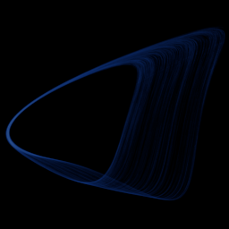

# Sprott simplest quadratic jerk

`sprott_jerk_sq` · flow · 3-D · family: Flows



The "simplest quadratic chaotic flow" x''' = −a·x'' + x'² − x. Only one quadratic term and one parameter — Sprott found it by brute-force search.

## Equations

```text
dx/dt = y
dy/dt = z
dz/dt = −a · z + y² − x
```

## Parameters

| Name | Default | Range | Meaning |
|---|---|---|---|
| a | 2.017 | [1.9, 2.2] | a — damping; chaos lives in a narrow window around 2.017. |

Integration: RK4, default dt = 0.02, initial condition (-0.5, 0.0, 0.0, 0.0).

## References

- J. C. Sprott, "Simplest dissipative chaotic flow", Phys. Lett. A 228 (1997)

## Source (`.atr`)

```text
name: Sprott simplest quadratic jerk
family: Flows
desc: The "simplest quadratic chaotic flow" x''' = −a·x'' + x'² − x. Only one quadratic term and one parameter — Sprott found it by brute-force search.
ref: J. C. Sprott, "Simplest dissipative chaotic flow", Phys. Lett. A 228 (1997)
tags: flow, jerk, 3d
dt: 0.02
ic: -0.5 0 0
jitter: 0.05
camera: 25 20 0 1

param a = 2.017 [1.9, 2.2] "a — damping; chaos lives in a narrow window around 2.017."

dx = y
dy = z
dz = -a*z + y^2 - x
```

Render it: `attractr render sprott_jerk_sq --size 2048x2048 --report md`
