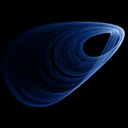

# Sprott N

`sprott_n` · flow · 3-D · family: Flows



One of J. C. Sprott's 19 simplest chaotic flows (case N) — five terms, one or two nonlinearities.

## Equations

```text
dx/dt = −a · y
dy/dt = x + z²
dz/dt = 1 + y − b · z
```

## Parameters

| Name | Default | Range | Meaning |
|---|---|---|---|
| a | 2 | [1, 3] |  |
| b | 2 | [1, 3] |  |

Integration: RK4, default dt = 0.02, initial condition (0.1, 0.1, 0.1).

## References

- J. C. Sprott, "Some simple chaotic flows", Phys. Rev. E 50 (1994)

## Source (`.atr`)

```text
name: Sprott N
family: Flows
desc: One of J. C. Sprott's 19 simplest chaotic flows (case N) — five terms, one or two nonlinearities.
ref: J. C. Sprott, "Some simple chaotic flows", Phys. Rev. E 50 (1994)
tags: flow, sprott, 3d
dt: 0.02
ic: 0.1 0.1 0.1
camera: 25 20 0 1

param a = 2.0 [1, 3]
param b = 2.0 [1, 3]

dx = -a*y
dy = x + z^2
dz = 1 + y - b*z
```

Render it: `attractr render sprott_n --size 2048x2048 --report md`
