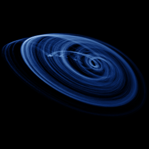

# Sprott O

`sprott_o` · flow · 3-D · family: Flows



One of J. C. Sprott's 19 simplest chaotic flows (case O) — five terms, one or two nonlinearities.

## Equations

```text
dx/dt = y
dy/dt = x − z
dz/dt = a · x + x · z + b · y
```

## Parameters

| Name | Default | Range | Meaning |
|---|---|---|---|
| a | 1 | [0.5, 2] |  |
| b | 2.7 | [1.5, 4] |  |

Integration: RK4, default dt = 0.02, initial condition (-0.19, 0.24, -0.12, 0.0).

## References

- J. C. Sprott, "Some simple chaotic flows", Phys. Rev. E 50 (1994)

## Source (`.atr`)

```text
name: Sprott O
family: Flows
desc: One of J. C. Sprott's 19 simplest chaotic flows (case O) — five terms, one or two nonlinearities.
ref: J. C. Sprott, "Some simple chaotic flows", Phys. Rev. E 50 (1994)
tags: flow, sprott, 3d
dt: 0.02
ic: -0.19 0.24 -0.12
camera: 25 20 0 1

param a = 1.0 [0.5, 2]
param b = 2.7 [1.5, 4]

dx = y
dy = x - z
dz = a*x + x*z + b*y
```

Render it: `attractr render sprott_o --size 2048x2048 --report md`
