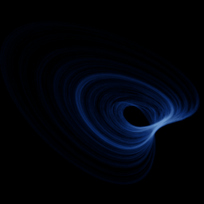

# Sprott R

`sprott_r` · flow · 3-D · family: Flows



One of J. C. Sprott's 19 simplest chaotic flows (case R) — five terms, one or two nonlinearities.

## Equations

```text
dx/dt = a − y
dy/dt = b + z
dz/dt = x · y − z
```

## Parameters

| Name | Default | Range | Meaning |
|---|---|---|---|
| a | 0.9 | [0.5, 1.5] |  |
| b | 0.4 | [0.1, 0.8] |  |

Integration: RK4, default dt = 0.02, initial condition (0.1, 0.1, 0.1, 0.0).

## References

- J. C. Sprott, "Some simple chaotic flows", Phys. Rev. E 50 (1994)

## Source (`.atr`)

```text
name: Sprott R
family: Flows
desc: One of J. C. Sprott's 19 simplest chaotic flows (case R) — five terms, one or two nonlinearities.
ref: J. C. Sprott, "Some simple chaotic flows", Phys. Rev. E 50 (1994)
tags: flow, sprott, 3d
dt: 0.02
ic: 0.1 0.1 0.1
camera: 25 20 0 1

param a = 0.9 [0.5, 1.5]
param b = 0.4 [0.1, 0.8]

dx = a - y
dy = b + z
dz = x*y - z
```

Render it: `attractr render sprott_r --size 2048x2048 --report md`
