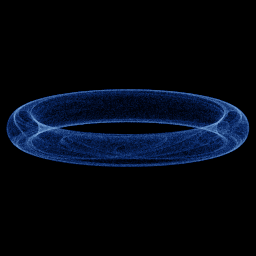

# Svensson

`svensson` · map · 2-D · family: Maps



Johnny Svensson's symmetric sine/cosine map — soft, veil-like sheets.

## Equations

```text
x′ = d · sin(a · x) − sin(b · y)
y′ = c · cos(a · x) + cos(b · y)
```

## Parameters

| Name | Default | Range | Meaning |
|---|---|---|---|
| a | 1.4 | [-3, 3] |  |
| b | 1.56 | [-3, 3] |  |
| c | 1.4 | [-3, 3] |  |
| d | -6.56 | [-8, 8] |  |

## References

- J. Svensson (1999)

## Source (`.atr`)

```text
name: Svensson
family: Maps
desc: Johnny Svensson's symmetric sine/cosine map — soft, veil-like sheets.
ref: J. Svensson (1999)
tags: map, 2d
dims: 2
warmup: 100

param a = 1.4 [-3, 3]
param b = 1.56 [-3, 3]
param c = 1.4 [-3, 3]
param d = -6.56 [-8, 8]

x' = d*sin(a*x) - sin(b*y)
y' = c*cos(a*x) + cos(b*y)
```

Render it: `attractr render svensson --size 2048x2048 --report md`
