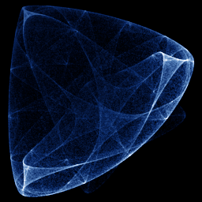

# Symmetric Icon

`symmetric_icon` · map · 3-D · family: Maps



Field & Golubitsky's symmetric icons. Complex polynomials with n-fold rotational symmetry produce mandala-like patterns, here lifted into a 3-D relief keyed to the symmetry (depth = Re zⁿ) so the camera has real depth to rotate.

## Equations

```text
zz = x · x + y · y
ren = re_pow(x, y, n)
t = λ + α · zz + β · ren
cr = re_pow(x, −y, n − 1)
ci = im_pow(x, −y, n − 1)
x′ = t · x − ω · y + γ · cr
y′ = t · y + ω · x + γ · ci
depth = ren
```

## Parameters

| Name | Default | Range | Meaning |
|---|---|---|---|
| lam | -2.5 | [-4, -1] | λ — overall contraction. More negative pulls orbits inward. |
| al | 5 | [1, 8] | α — radial nonlinearity (|z|² term). |
| be | -1.8 | [-3, 0.5] | β — strength of the n-fold Re(zⁿ) modulation. |
| ga | 1 | [-2, 2] | γ — conj(z)^(n−1) term that creates the petals. |
| om | 0 | [-1, 1] | ω — rotation; non-zero breaks mirror symmetry (pinwheel icons). |
| n | 3 | [3, 12] | Symmetry order. |

## References

- M. Field & M. Golubitsky, "Symmetry in Chaos" (1992)

## Source (`.atr`)

```text
name: Symmetric Icon
family: Maps
desc: Field & Golubitsky's symmetric icons. Complex polynomials with n-fold rotational symmetry produce mandala-like patterns, here lifted into a 3-D relief keyed to the symmetry (depth = Re zⁿ) so the camera has real depth to rotate.
ref: M. Field & M. Golubitsky, "Symmetry in Chaos" (1992)
tags: map, icon, 3d
warmup: 200
camera: 25 30 0 1

param lam = -2.5 [-4, -1] "λ — overall contraction. More negative pulls orbits inward."
param al = 5.0 [1, 8] "α — radial nonlinearity (|z|² term)."
param be = -1.8 [-3, 0.5] "β — strength of the n-fold Re(zⁿ) modulation."
param ga = 1.0 [-2, 2] "γ — conj(z)^(n−1) term that creates the petals."
param om = 0.0 [-1, 1] "ω — rotation; non-zero breaks mirror symmetry (pinwheel icons)."
param n = 3 [3, 12] int "Symmetry order."

zz  = x*x + y*y
ren = re_pow(x, y, n)
t   = lam + al*zz + be*ren
cr  = re_pow(x, -y, n - 1)
ci  = im_pow(x, -y, n - 1)
x'  = t*x - om*y + ga*cr
y'  = t*y + om*x + ga*ci
depth = ren
```

Render it: `attractr render symmetric_icon --size 2048x2048 --report md`
