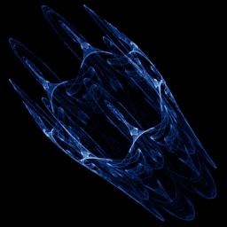

# Symmetric Icon (extended)

`symmetric_icon_ext` · map · 3-D · family: Maps



The full Chossat–Golubitsky / Field–Golubitsky icon with the extra δ·Re((z/|z|)ⁿᵖ)·|z| term that "Symmetry in Chaos" uses for its pinwheel and swirl icons. Set δ = 0 to recover the basic icon.

## Equations

```text
zz = x · x + y · y
r = sqrt(zz) + 1e-12
ren = re_pow(x, y, n)
cnp = re_pow(x / r, y / r, n · p)
t = λ + α · zz + β · ren + de · cnp · r
cr = re_pow(x, −y, n − 1)
ci = im_pow(x, −y, n − 1)
x′ = t · x − ω · y + γ · cr
y′ = t · y + ω · x + γ · ci
depth = ren
```

## Parameters

| Name | Default | Range | Meaning |
|---|---|---|---|
| lam | -2.08 | [-4, -1] | λ — overall contraction. |
| al | 1 | [-2, 8] | α — |z|² term. |
| be | -0.1 | [-3, 3] | β — Re(zⁿ) term. |
| ga | 0.167 | [-2, 2] | γ — conj(z)^(n−1) term. |
| de | 0 | [-1, 1] | δ — Re((z/|z|)^(n·p))·|z| term (swirls). |
| om | 0 | [-1, 1] | ω — rotation (pinwheel when non-zero). |
| n | 7 | [3, 12] | Symmetry order n. |
| p | 1 | [1, 4] | Harmonic multiplier p of the δ term. |

## References

- P. Chossat & M. Golubitsky, "Symmetry-increasing bifurcation of chaotic attractors", Physica D 32 (1988); M. Field & M. Golubitsky, "Symmetry in Chaos" (1992)

## Source (`.atr`)

```text
name: Symmetric Icon (extended)
family: Maps
desc: The full Chossat–Golubitsky / Field–Golubitsky icon with the extra δ·Re((z/|z|)ⁿᵖ)·|z| term that "Symmetry in Chaos" uses for its pinwheel and swirl icons. Set δ = 0 to recover the basic icon.
ref: P. Chossat & M. Golubitsky, "Symmetry-increasing bifurcation of chaotic attractors", Physica D 32 (1988); M. Field & M. Golubitsky, "Symmetry in Chaos" (1992)
tags: map, icon, 3d
warmup: 200
camera: 25 30 0 1
ic: 0.3 0.2 0

param lam = -2.08 [-4, -1] "λ — overall contraction."
param al = 1.0 [-2, 8] "α — |z|² term."
param be = -0.1 [-3, 3] "β — Re(zⁿ) term."
param ga = 0.167 [-2, 2] "γ — conj(z)^(n−1) term."
param de = 0.0 [-1, 1] "δ — Re((z/|z|)^(n·p))·|z| term (swirls)."
param om = 0.0 [-1, 1] "ω — rotation (pinwheel when non-zero)."
param n = 7 [3, 12] int "Symmetry order n."
param p = 1 [1, 4] int "Harmonic multiplier p of the δ term."

zz  = x*x + y*y
r   = sqrt(zz) + 1e-12
ren = re_pow(x, y, n)
cnp = re_pow(x/r, y/r, n*p)
t   = lam + al*zz + be*ren + de*cnp*r
cr  = re_pow(x, -y, n - 1)
ci  = im_pow(x, -y, n - 1)
x'  = t*x - om*y + ga*cr
y'  = t*y + om*x + ga*ci
depth = ren
```

Render it: `attractr render symmetric_icon_ext --size 2048x2048 --report md`
