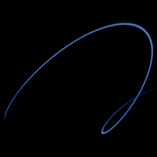

# Three-scroll unified

`three_scroll` · flow · 3-D · family: Flows



The three-scroll unified chaotic system (TSUCS) — three nested scrolls.

## Equations

```text
dx/dt = a · (y − x) + d · x · z
dy/dt = c · y − x · z
dz/dt = b · z + x · y − e · x²
```

## Parameters

| Name | Default | Range | Meaning |
|---|---|---|---|
| a | 40 | [30, 50] |  |
| b | 0.833 | [0.5, 1.2] |  |
| c | 20 | [10, 30] |  |
| d | 0.5 | [0, 1] |  |
| e | 0.65 | [0, 1] |  |

Integration: RK4, default dt = 0.0005, initial condition (0.1, 0.1, 0.1, 0.0).

## References

- L. Pan, D. Xu & W. Zhou, Int. J. Bifurcation Chaos (2010)

## Source (`.atr`)

```text
name: Three-scroll unified
family: Flows
desc: The three-scroll unified chaotic system (TSUCS) — three nested scrolls.
ref: L. Pan, D. Xu & W. Zhou, Int. J. Bifurcation Chaos (2010)
tags: flow, 3d
dt: 0.0005
ic: 0.1 0.1 0.1
camera: 25 20 0 1

param a = 40 [30, 50]
param b = 0.833 [0.5, 1.2]
param c = 20 [10, 30]
param d = 0.5 [0, 1]
param e = 0.65 [0, 1]

dx = a*(y - x) + d*x*z
dy = c*y - x*z
dz = b*z + x*y - e*x^2
```

Render it: `attractr render three_scroll --size 2048x2048 --report md`
