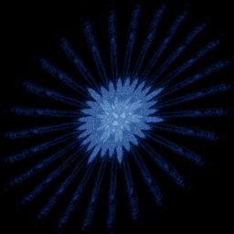

# Threeply

`threeply` · map · 2-D · family: Maps



The third of Barry Martin's Scientific American maps. A three-fold sinusoidal fold gives interlocking plies of points.

## Equations

```text
x′ = y − sign(x) · abs(sin(x) · cos(b) + c − x · sin(a + b + c))
y′ = a − x
```

## Parameters

| Name | Default | Range | Meaning |
|---|---|---|---|
| a | -55 | [-100, 100] |  |
| b | -1 | [-5, 5] |  |
| c | -42 | [-100, 100] |  |

## References

- B. Martin, in A. K. Dewdney, Scientific American (1986); P. Bourke, "Threeply"

## Source (`.atr`)

```text
name: Threeply
family: Maps
desc: The third of Barry Martin's Scientific American maps. A three-fold sinusoidal fold gives interlocking plies of points.
ref: B. Martin, in A. K. Dewdney, Scientific American (1986); P. Bourke, "Threeply"
tags: map, 2d, classic
dims: 2
ic: 0 0 0
jitter: 0.5
warmup: 100

param a = -55 [-100, 100]
param b = -1 [-5, 5]
param c = -42 [-100, 100]

x' = y - sign(x)*abs(sin(x)*cos(b) + c - x*sin(a + b + c))
y' = a - x
```

Render it: `attractr render threeply --size 2048x2048 --report md`
