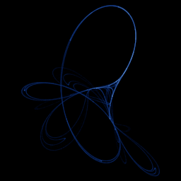

# Tinkerbell

`tinkerbell` · map · 2-D · family: Maps



The Tinkerbell map — a fairy-wing shaped attractor from a quadratic recurrence.

## Equations

```text
x′ = x² − y² + a · x + b · y
y′ = 2 · x · y + c · x + d · y
```

## Parameters

| Name | Default | Range | Meaning |
|---|---|---|---|
| a | 0.9 | [-1, 1] |  |
| b | -0.6013 | [-1, 1] |  |
| c | 2 | [0, 3] |  |
| d | 0.5 | [-1, 1] |  |

## References

- https://en.wikipedia.org/wiki/Tinkerbell_map

## Source (`.atr`)

```text
name: Tinkerbell
family: Maps
desc: The Tinkerbell map — a fairy-wing shaped attractor from a quadratic recurrence.
ref: https://en.wikipedia.org/wiki/Tinkerbell_map
tags: map, 2d
dims: 2
ic: -0.72 -0.64 0
jitter: 0.01
warmup: 200

param a = 0.9 [-1, 1]
param b = -0.6013 [-1, 1]
param c = 2.0 [0, 3]
param d = 0.5 [-1, 1]

x' = x^2 - y^2 + a*x + b*y
y' = 2*x*y + c*x + d*y
```

Render it: `attractr render tinkerbell --size 2048x2048 --report md`
