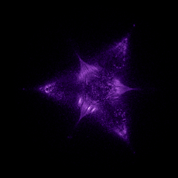

# Tricorn (escape orbits)

`tricorn_brot` · escape · 2-D · family: Escape



Escaping orbits of the Mandelbar / Tricorn iteration z → conj(z)² + c. Its three-fold symmetry replaces the Buddhabrot's seated figure with a three-pointed star of orbit trails.

## Equations

```text
x′ = x · x − y · y + x0
y′ = −2 · x · y + y0
color = w
```

## References

- W. D. Crowe et al., "On the structure of the Mandelbar set", Nonlinearity 2 (1989)

## Source (`.atr`)

```text
name: Tricorn (escape orbits)
family: Escape
desc: Escaping orbits of the Mandelbar / Tricorn iteration z → conj(z)² + c. Its three-fold symmetry replaces the Buddhabrot's seated figure with a three-pointed star of orbit trails.
ref: W. D. Crowe et al., "On the structure of the Mandelbar set", Nonlinearity 2 (1989)
tags: escape, fractal, 2d
kind: escape
dims: 2
region: -2.2 1.8 -2.0 2.0
bailout: 2
max_iter: 400
min_iter: 10
boost: 20
camera: 0 0 0 1
palette: aurora

x' = x*x - y*y + x0
y' = -2*x*y + y0
color = w
```

Render it: `attractr render tricorn_brot --size 2048x2048 --report md`
