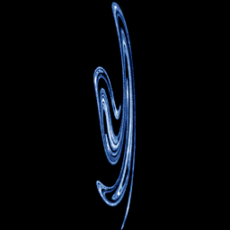

# Ueda (stroboscopic map)

`ueda_strobe` · flow · 2-D · family: Flows



Ueda's oscillator sampled once per forcing period (period 2π): the "Japanese attractor" / broken-egg Poincaré section. Only one step in ~600 is plotted, so the iteration budget is boosted 300×.

## Equations

```text
dx/dt = y
dy/dt = −k · y − x³ + B · cos(w)
dz/dt = 0
dw = 1
plot = x, y, 0
section = sin(w / 2)
```

## Parameters

| Name | Default | Range | Meaning |
|---|---|---|---|
| k | 0.05 | [0, 0.5] | k — damping. |
| B | 7.5 | [0, 15] | B — forcing amplitude. |

Integration: RK4, default dt = 0.01, initial condition (2.5, 0.0, 0.0, 0.0).

## References

- Y. Ueda, "The Road to Chaos" (1992)

## Source (`.atr`)

```text
name: Ueda (stroboscopic map)
family: Flows
desc: Ueda's oscillator sampled once per forcing period (period 2π): the "Japanese attractor" / broken-egg Poincaré section. Only one step in ~600 is plotted, so the iteration budget is boosted 300×.
ref: Y. Ueda, "The Road to Chaos" (1992)
tags: flow, driven, section, 2d
dt: 0.01
ic: 2.5 0 0 0
camera: 0 0 0 1
warmup: 5000
boost: 300

param k = 0.05 [0, 0.5] "k — damping."
param B = 7.5 [0, 15] "B — forcing amplitude."

dx = y
dy = -k*y - x^3 + B*cos(w)
dz = 0
dw = 1
plot = x, y, 0
section = sin(w/2)
```

Render it: `attractr render ueda_strobe --size 2048x2048 --report md`
