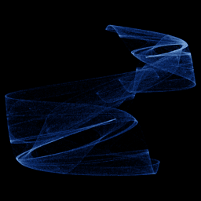

# Ushiki

`ushiki` · map · 2-D · family: Maps



Shigehiro Ushiki's two-species predator–prey map — a discrete Lotka–Volterra. Sharp cusps and spikes radiate from a folded core.

## Equations

```text
x′ = (a − x − b · y) · x
y′ = (c − y − d · x) · y
```

## Parameters

| Name | Default | Range | Meaning |
|---|---|---|---|
| a | 3.7 | [2.5, 4] | Growth rate of species x. |
| b | 0.1 | [-0.5, 0.5] | Effect of y on x. |
| c | 3.5 | [2.5, 4] | Growth rate of species y. |
| d | 0.15 | [-0.5, 0.5] | Effect of x on y. |

## References

- S. Ushiki, "Chaotic phenomena and fractal objects in numerical analysis" (1986)

## Source (`.atr`)

```text
name: Ushiki
family: Maps
desc: Shigehiro Ushiki's two-species predator–prey map — a discrete Lotka–Volterra. Sharp cusps and spikes radiate from a folded core.
ref: S. Ushiki, "Chaotic phenomena and fractal objects in numerical analysis" (1986)
tags: map, 2d
dims: 2
ic: 0.1 0.1 0
jitter: 0.05
warmup: 200

param a = 3.7 [2.5, 4] "Growth rate of species x."
param b = 0.1 [-0.5, 0.5] "Effect of y on x."
param c = 3.5 [2.5, 4] "Growth rate of species y."
param d = 0.15 [-0.5, 0.5] "Effect of x on y."

x' = (a - x - b*y)*x
y' = (c - y - d*x)*y
```

Render it: `attractr render ushiki --size 2048x2048 --report md`
