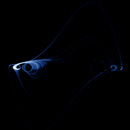

# Van der Pol (driven)

`van_der_pol_driven` · flow · 2-D · family: Flows



The forced van der Pol relaxation oscillator x'' − μ(1 − x²)x' + x = A cos(ωt), the system in which Cartwright & Littlewood (1945) first proved that deterministic equations can behave chaotically.

## Equations

```text
dx/dt = y
dy/dt = μ · (1 − x²) · y − x + A · cos(ω · w)
dz/dt = 0
dw = 1
plot = x, y · yscale, 0
```

## Parameters

| Name | Default | Range | Meaning |
|---|---|---|---|
| mu | 5 | [0, 12] | μ — nonlinear damping (relaxation strength). |
| A | 5 | [0, 8] | A — forcing amplitude. |
| yscale | 0.25 | [0.05, 1] | Vertical scale applied to x' in the picture (the velocity swings are large). |
| omega | 2.463 | [0.2, 4] | ω — forcing frequency (μ = 5, A = 5, ω = 2.463 is the chaotic case of Parlitz & Lauterborn). |

Integration: RK4, default dt = 0.005, initial condition (0.1, 0.0, 0.0, 0.0).

## References

- M. L. Cartwright & J. E. Littlewood, J. London Math. Soc. 20 (1945); U. Parlitz & W. Lauterborn, Phys. Rev. A 36 (1987)

## Source (`.atr`)

```text
name: Van der Pol (driven)
family: Flows
desc: The forced van der Pol relaxation oscillator x'' − μ(1 − x²)x' + x = A cos(ωt), the system in which Cartwright & Littlewood (1945) first proved that deterministic equations can behave chaotically.
ref: M. L. Cartwright & J. E. Littlewood, J. London Math. Soc. 20 (1945); U. Parlitz & W. Lauterborn, Phys. Rev. A 36 (1987)
tags: flow, driven, 2d
dt: 0.005
ic: 0.1 0 0 0
camera: 0 0 0 1

param mu = 5 [0, 12] "μ — nonlinear damping (relaxation strength)."
param A = 5 [0, 8] "A — forcing amplitude."
param yscale = 0.25 [0.05, 1] "Vertical scale applied to x' in the picture (the velocity swings are large)."
param omega = 2.463 [0.2, 4] "ω — forcing frequency (μ = 5, A = 5, ω = 2.463 is the chaotic case of Parlitz & Lauterborn)."

dx = y
dy = mu*(1 - x^2)*y - x + A*cos(omega*w)
dz = 0
dw = 1
plot = x, y*yscale, 0
```

Render it: `attractr render van_der_pol_driven --size 2048x2048 --report md`
