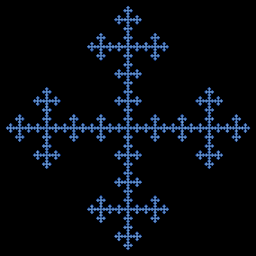

# Vicsek fractal

`vicsek` · ifs · 2-D · family: IFS



Tamás Vicsek's cross-shaped fractal: five copies at ratio 1/3 — the centre and the four edge midpoints (set corner = 1 for the diagonal "x" form).

## Equations

```text
g = (1 − s) / 2
ee = 1 − s
with p = 1:
    x′ = s · x + g
    y′ = s · y + g
with p = 1:
    x′ = s · x + select(corner = 1, 0, g)
    y′ = s · y
with p = 1:
    x′ = s · x + select(corner = 1, 0, g)
    y′ = s · y + ee
with p = 1:
    x′ = s · x + select(corner = 1, ee, 0)
    y′ = s · y + select(corner = 1, 0, g)
with p = 1:
    x′ = s · x + ee
    y′ = s · y + select(corner = 1, ee, g)
```

## Parameters

| Name | Default | Range | Meaning |
|---|---|---|---|
| s | 0.3333 | [0.2, 0.5] | Contraction ratio. |
| corner | 0 | [0, 1] | 0: copies on the edges (plus shape), 1: copies in the corners (saltire). |

## References

- T. Vicsek, "Fractal Growth Phenomena" (1989)

## Source (`.atr`)

```text
name: Vicsek fractal
family: IFS
desc: Tamás Vicsek's cross-shaped fractal: five copies at ratio 1/3 — the centre and the four edge midpoints (set corner = 1 for the diagonal "x" form).
ref: T. Vicsek, "Fractal Growth Phenomena" (1989)
tags: ifs, 2d, classic
dims: 2
warmup: 20
ic: 0.5 0.5 0

param s = 0.3333 [0.2, 0.5] "Contraction ratio."
param corner = 0 [0, 1] int "0: copies on the edges (plus shape), 1: copies in the corners (saltire)."

g  = (1 - s)/2
ee = 1 - s
choose {
  1: x' = s*x + g;                          y' = s*y + g
  1: x' = s*x + select(corner == 1, 0, g);  y' = s*y
  1: x' = s*x + select(corner == 1, 0, g);  y' = s*y + ee
  1: x' = s*x + select(corner == 1, ee, 0);  y' = s*y + select(corner == 1, 0, g)
  1: x' = s*x + ee;                          y' = s*y + select(corner == 1, ee, g)
}
```

Render it: `attractr render vicsek --size 2048x2048 --report md`
