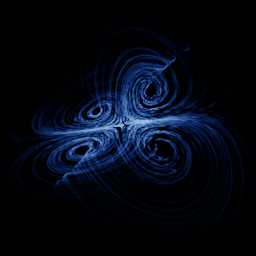

# Wang–Sun

`wang_sun` · flow · 3-D · family: Flows



A quadratic system from 2010 with a single wing whose surface is almost a smooth sheet — a "one-wing" relative of Lorenz.

## Equations

```text
dx/dt = a · x + c · y · z
dy/dt = b · x + d · y − x · z
dz/dt = e · z + f · x · y
```

## Parameters

| Name | Default | Range | Meaning |
|---|---|---|---|
| a | 0.2 | [0, 1] |  |
| b | -0.01 | [-0.5, 0.5] |  |
| c | 1 | [0, 2] |  |
| d | -0.4 | [-1, 0] |  |
| e | -1 | [-2, 0] |  |
| f | -1 | [-2, 0] |  |

Integration: RK4, default dt = 0.02, initial condition (0.5, 0.1, 0.1, 0.0).

## References

- Z. Wang, Y. Sun, B. J. van Wyk, G. Qi, M. A. van Wyk, "A 3-D four-wing attractor and its analysis", Braz. J. Phys. 39 (2009)

## Source (`.atr`)

```text
name: Wang–Sun
family: Flows
desc: A quadratic system from 2010 with a single wing whose surface is almost a smooth sheet — a "one-wing" relative of Lorenz.
ref: Z. Wang, Y. Sun, B. J. van Wyk, G. Qi, M. A. van Wyk, "A 3-D four-wing attractor and its analysis", Braz. J. Phys. 39 (2009)
tags: flow, 3d
dt: 0.02
ic: 0.5 0.1 0.1
camera: 25 20 0 1

param a = 0.2 [0, 1]
param b = -0.01 [-0.5, 0.5]
param c = 1 [0, 2]
param d = -0.4 [-1, 0]
param e = -1 [-2, 0]
param f = -1 [-2, 0]

dx = a*x + c*y*z
dy = b*x + d*y - x*z
dz = e*z + f*x*y
```

Render it: `attractr render wang_sun --size 2048x2048 --report md`
