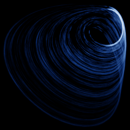

# Wei (no equilibrium)

`wei` · flow · 3-D · family: Flows



Zhouchao Wei's 2011 system — a three-dimensional quadratic flow with *no equilibrium points at all* and yet a strange attractor (a "hidden" attractor). A single constant term does the trick.

## Equations

```text
dx/dt = −y
dy/dt = x + z
dz/dt = 2 · y² + x · z − a
```

## Parameters

| Name | Default | Range | Meaning |
|---|---|---|---|
| a | 0.35 | [0.1, 1] | a — the constant offset; no equilibria exist for any a > 0. |

Integration: RK4, default dt = 0.005, initial condition (0.5, 0.5, 0.0, 0.0).

## References

- Z. Wei, "Dynamical behaviors of a chaotic system with no equilibria", Phys. Lett. A 376 (2011)

## Source (`.atr`)

```text
name: Wei (no equilibrium)
family: Flows
desc: Zhouchao Wei's 2011 system — a three-dimensional quadratic flow with *no equilibrium points at all* and yet a strange attractor (a "hidden" attractor). A single constant term does the trick.
ref: Z. Wei, "Dynamical behaviors of a chaotic system with no equilibria", Phys. Lett. A 376 (2011)
tags: flow, 3d, hidden
dt: 0.005
ic: 0.5 0.5 0
jitter: 0.05
camera: 25 20 0 1

param a = 0.35 [0.1, 1] "a — the constant offset; no equilibria exist for any a > 0."

dx = -y
dy = x + z
dz = 2*y^2 + x*z - a
```

Render it: `attractr render wei --size 2048x2048 --report md`
