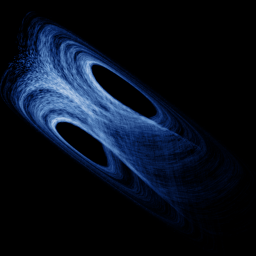

# Yu-Wang

`yu_wang` · flow · 3-D · family: Flows



A system with an exponential nonlinearity — a fat, butterfly-like attractor.

## Equations

```text
dx/dt = a · (y − x)
dy/dt = b · x − c · x · z
dz/dt = exp(x · y) − d · z
```

## Parameters

| Name | Default | Range | Meaning |
|---|---|---|---|
| a | 10 | [5, 15] |  |
| b | 40 | [30, 50] |  |
| c | 2 | [1, 3] |  |
| d | 2.5 | [1.5, 3.5] |  |

Integration: RK4, default dt = 0.002, initial condition (0.1, 0.1, 20.0).

## References

- F. Yu & C. Wang, Eng. Technol. Appl. Sci. Res. (2012)

## Source (`.atr`)

```text
name: Yu-Wang
family: Flows
desc: A system with an exponential nonlinearity — a fat, butterfly-like attractor.
ref: F. Yu & C. Wang, Eng. Technol. Appl. Sci. Res. (2012)
tags: flow, 3d
dt: 0.002
ic: 0.1 0.1 20
camera: 25 20 0 1

param a = 10 [5, 15]
param b = 40 [30, 50]
param c = 2 [1, 3]
param d = 2.5 [1.5, 3.5]

dx = a*(y - x)
dy = b*x - c*x*z
dz = exp(x*y) - d*z
```

Render it: `attractr render yu_wang --size 2048x2048 --report md`
