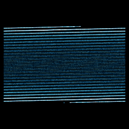

# Zaslavskii web map

`zaslavskii` · map · 2-D · family: Maps



George Zaslavskii's dissipative kicked-rotor map (1978). A periodic kick wrapped modulo 1 in x builds a "stochastic web" — filaments of chaos woven through the torus.

## Equations

```text
mu = (1 − exp(−r)) / r
x′ = mod(x + v · (1 + μ · y) + ε · v · μ · cos(2 · 3.141592654 · x), 1)
y′ = exp(−r) · (y + ε · cos(2 · 3.141592654 · x))
plot = x, y · yscale, 0
```

## Parameters

| Name | Default | Range | Meaning |
|---|---|---|---|
| v | 133.33 | [50, 300] | ν — kick strength (the classic value is 400/3). |
| r | 3 | [0.5, 6] | r — dissipation; larger squeezes y towards zero. |
| eps | 0.3 | [0, 1] | ε — amplitude of the cosine kick. |
| yscale | 20 | [1, 60] | Vertical stretch of the picture (y is squeezed by e⁻ʳ). |

## References

- G. M. Zaslavskii, "The simplest case of a strange attractor", Phys. Lett. A 69 (1978)

## Source (`.atr`)

```text
name: Zaslavskii web map
family: Maps
desc: George Zaslavskii's dissipative kicked-rotor map (1978). A periodic kick wrapped modulo 1 in x builds a "stochastic web" — filaments of chaos woven through the torus.
ref: G. M. Zaslavskii, "The simplest case of a strange attractor", Phys. Lett. A 69 (1978)
tags: map, 2d, classic
dims: 2
ic: 0.3 0.1 0
jitter: 0.2
warmup: 200
palette: ice

param v = 133.33 [50, 300] "ν — kick strength (the classic value is 400/3)."
param r = 3.0 [0.5, 6] "r — dissipation; larger squeezes y towards zero."
param eps = 0.3 [0, 1] "ε — amplitude of the cosine kick."
param yscale = 20 [1, 60] "Vertical stretch of the picture (y is squeezed by e⁻ʳ)."

mu = (1 - exp(-r))/r
x' = mod(x + v*(1 + mu*y) + eps*v*mu*cos(2*pi*x), 1)
y' = exp(-r)*(y + eps*cos(2*pi*x))
plot = x, y*yscale, 0
```

Render it: `attractr render zaslavskii --size 2048x2048 --report md`
