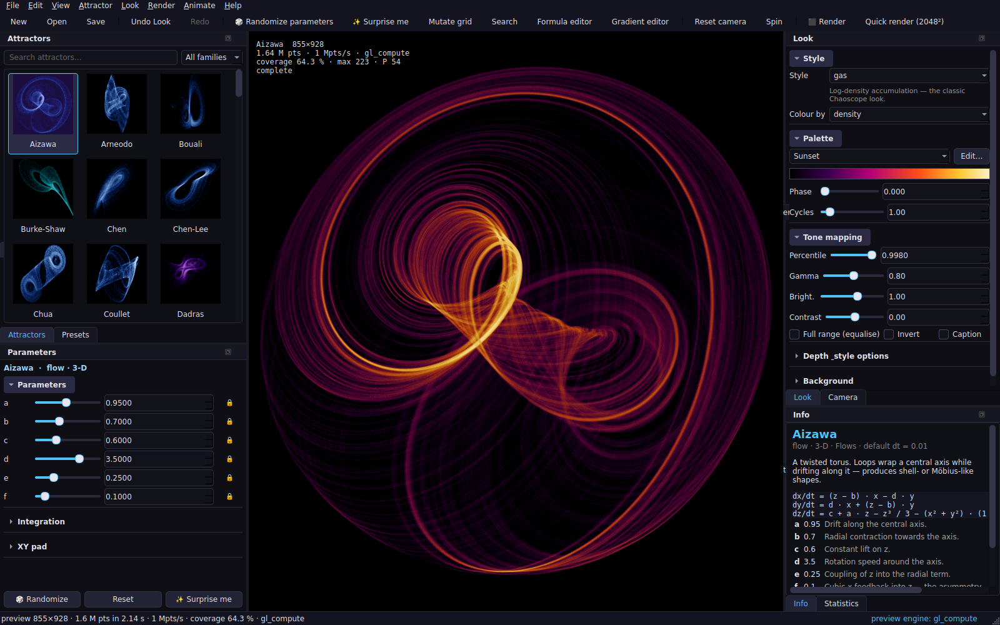

# GUI guide

## Layout

Everything except the viewport is a dock: drag, float, close and re-open from **View**.
The layout is remembered between sessions.

| Dock | What it does |
|---|---|
| **Attractors** | thumbnails of every built-in and user attractor, grouped by family, with search. Click to load. |
| **Parameters** | a slider + spin box per parameter (right-click: reset, edit range, widen/narrow, lock), integrator/dt/sub-steps for flows, XY pad, Randomize / Reset / Surprise me. |
| **Presets** | curated presets (ported from Chaoscope), your saved presets, Attractor of the Day, copy/paste `ATR1:` share codes (Chaoscope `CHS1:` codes are imported too). |
| **Look** | style, colour source, palette (+ gradient editor), tone mapping (percentile, gamma, brightness, contrast, equalise, invert, caption), depth/style options, lighting, background. |
| **Camera** | yaw / pitch / roll / zoom / pan / perspective, framing mode, presets. |
| **Info** | description, formula, parameter meanings, references. |
| **Statistics** | live render statistics + density histogram with the tone curve; Dynamics (Lyapunov, dimension); System (engine probe). |
| **Formula** (`F4`) | the DSL editor — see formula_dsl.md. |
| **Search** (`Ctrl+F`) | random parameter search filtered by Lyapunov exponent, with thumbnails. |
| **Gallery** | your rendered images: open, re-open their settings, show folder. |
| **Timeline** (`T`) | keyframe animation — see animation.md. |
| **Jobs** | render / animation queue with progress, ETA and cancel. |

## Viewport

Left-drag rotates (3-D) or pans (2-D); right-drag rolls; middle/Shift-drag pans; wheel
zooms about the cursor; double-click resets the camera; `Space` spins; `H` toggles the
HUD. Hovering shows the pixel probe (count, density, depth, colour value) in the status
bar. The preview is progressive: a coarse pass appears within a frame of any change and
refines while idle; look changes re-develop instantly without re-iterating.

## Rendering

**Render…** (`Ctrl+R`) opens the non-modal render dialog: size presets up to 8K/print,
quality tiers (points per pixel), engine, supersampling, splat radius, output folder and
naming template, format and bit depth, and the **Write render report** checkbox with a
format drop-down (Markdown / Text / HTML / PDF). **Quick render** (`Ctrl+Shift+R`) renders
2048² with the last settings. Jobs run in the background; results appear in the Gallery.

## Keyboard shortcuts

`Ctrl+N/O/S` new/open/save · `Ctrl+Z/Y` undo/redo · `R` randomize · `Shift+R` surprise ·
`M` mutate grid · `Ctrl+F` search · `F4` formula · `G` gradient editor · `T` timeline ·
`Ctrl+R` render · `Ctrl+Shift+R` quick render · `Ctrl+Shift+A` render animation ·
`Ctrl+Shift+C/V` copy/paste share code · `Home` reset camera · `Space` spin · `H` HUD.

## Files

Projects are `.attractr` JSON files (File menu); the session is autosaved every 30 s to
`~/.attractr/autosave.attractr` and offered for recovery after a crash. Exported PNGs
carry their settings; **File → Import settings from image…** or the Gallery re-open them.
